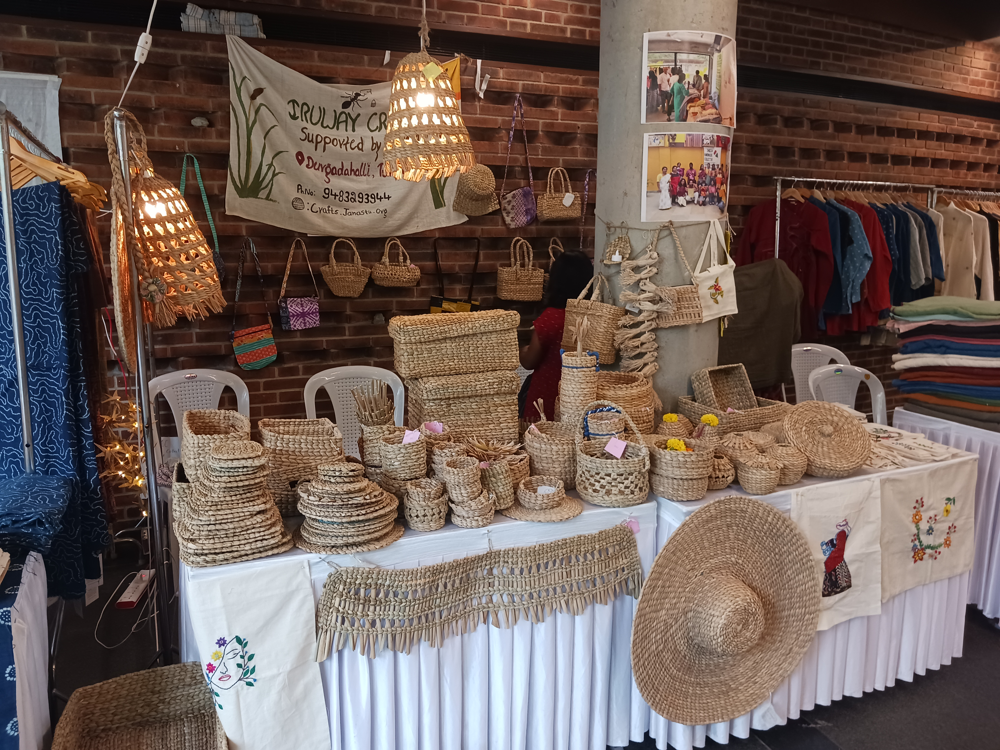
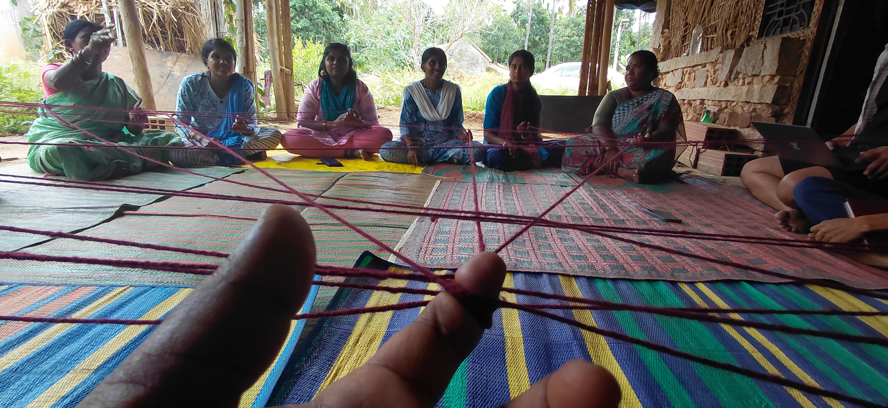
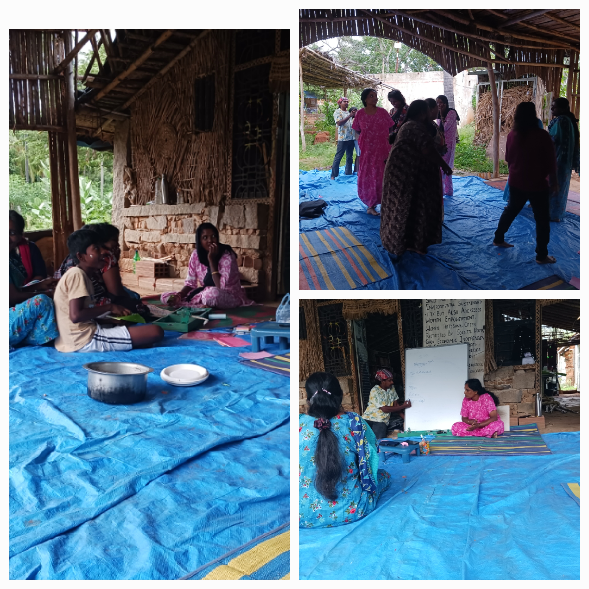
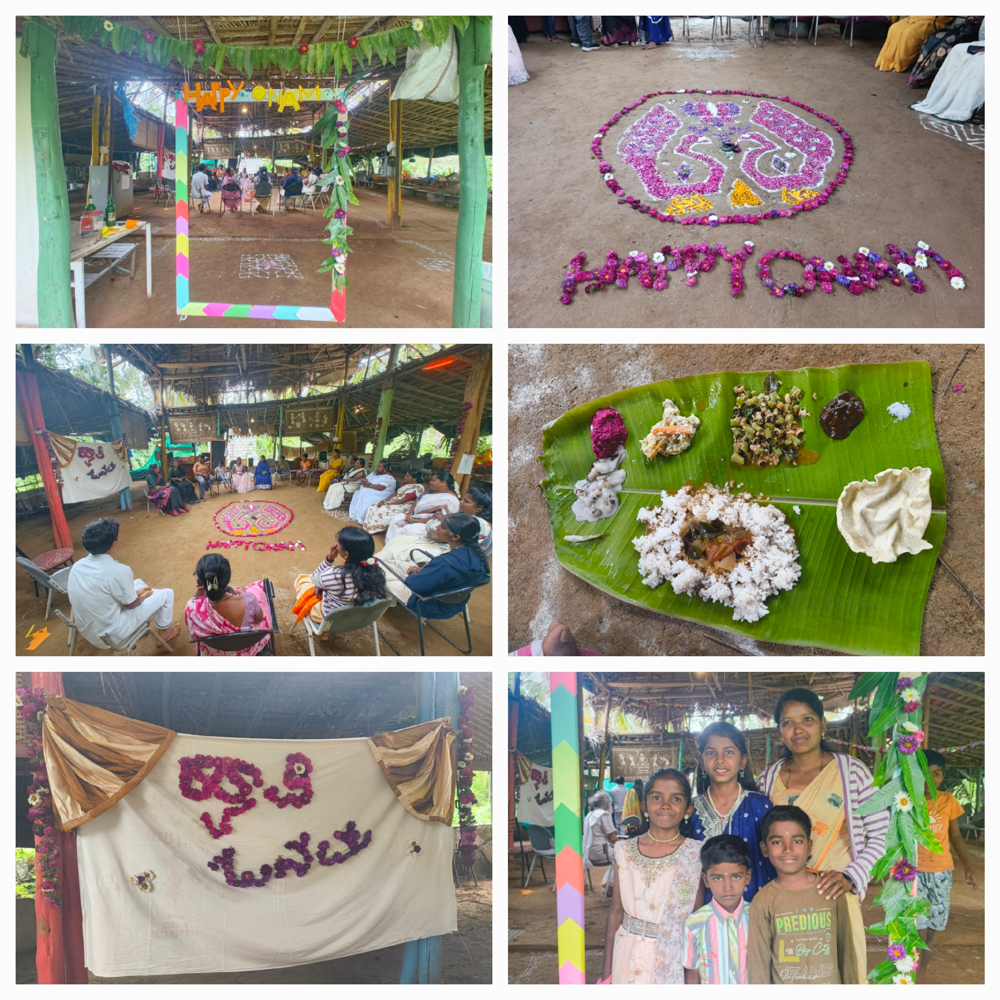
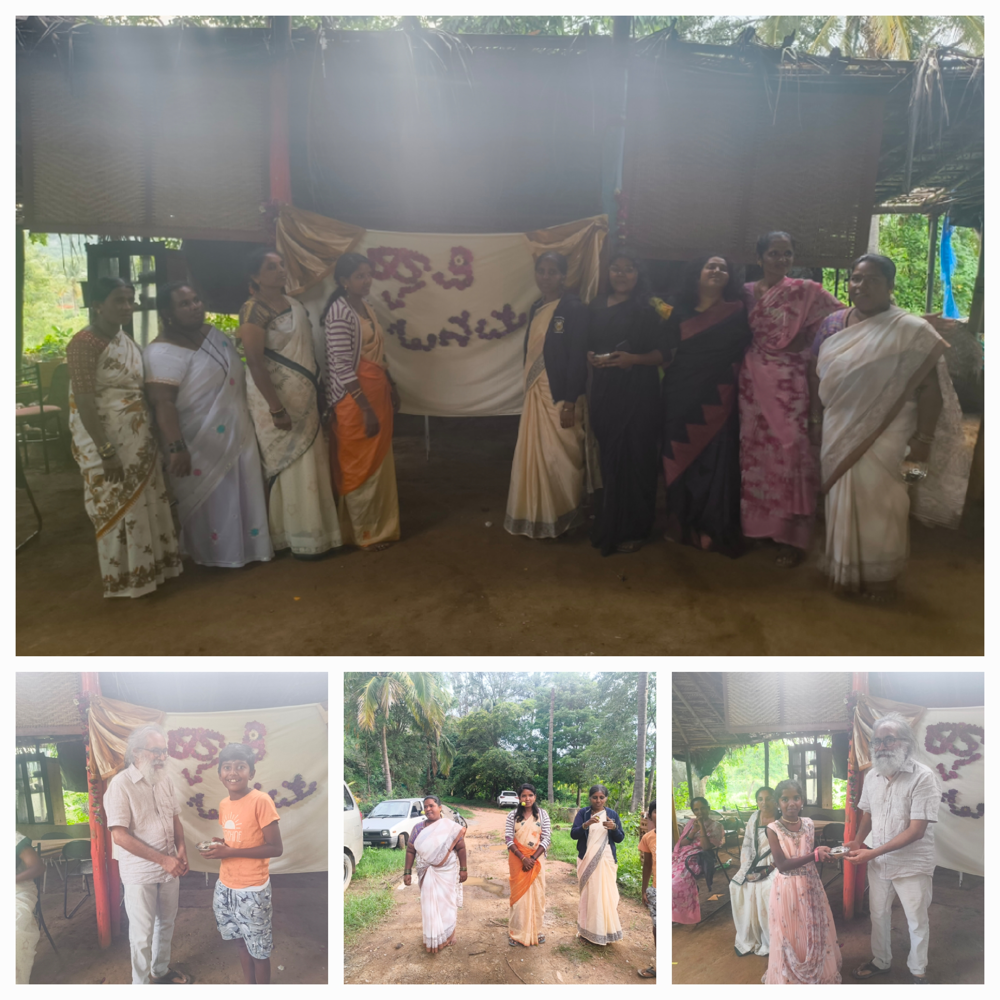

# Community, connection and inclusive economic opportunities: A glimpse of recent activities and updates from CrafterSpace

The recent months at CrafterSpace have been filled with craft, learning, celebrations, and opportunities to connect with one another. Alongside making products, the women have been exploring new ideas, sharing their skills, reading stories, practising yoga, and taking their crafts to new audiences.

Here's a glimpse of what we've been up to\!

## Taking our artisans’ crafts to new audiences

Over the past few months, we've taken the women's handmade products to exhibitions, stores, and gatherings across India.

Our crafts have been well received by visitors to the India Handmade Collective (IHMC), with whom we’ve been actively collaborating. We've sent products to IHMC’s gallery in Hyderabad and Mysuru and participated in their exhibitions in Gujarat, Mysuru, Hyderabad and Bengaluru. We also continue to participate in Ragi Kana, organized by the Gram Seva Sangha, and other *santhe’s* (fairs) around Karnataka.

Picture: At IHMC’s exhibition in Bangalore International Centre, Domlur.

Beyond exhibiting their work, the women have been sharing their skills directly with others. At Ambedkar Bhavan's Bodhi Park in Bengaluru, they conducted a workshop teaching participants to weave baskets from *jondu*, the bulrush grass they work with. We also conducted workshops on weaving with jondu as part of IHMC’s eco workshops in Ahmedabad during September.

\<Add photos here from workshops\> 

Each product takes time, effort, and skill to make. The women look forward to seeing their work displayed at exhibitions and are delighted when their creations find buyers. These opportunities help their work reach new audiences while giving greater visibility to the knowledge and craftsmanship they bring to it.

We're grateful to everyone who has welcomed our products and supported the women through their purchases.

## Web of Gratitude
In July, we held a workshop facilitated by Aarjav Chauhan to explore how people from different backgrounds within Janastu and CrafterSpace could understand one another better and strengthen their relationships.
We sat in a circle and passed a ball of yarn from one person to another, expressing thanks for specific support received over the previous month. As the yarn travelled around the circle, it formed a web of connections, with each strand representing an act of kindness, support, or appreciation.

Passing the yarn

There were many heartwarming moments during the activity. Experienced tailors thanked younger colleagues for helping them decode instructions on using new machines, while weavers expressed gratitude to those who sourced the bulrush grass they work with. Others appreciated the Janastu staff who keep the internet running, which helps the women explore new techniques and ideas available online. The day ended with an impromptu Kannada reading session, with the women sharing short stories and reflecting on them together.
The workshop served to remind us how everyday acts of support and the knowledge we share bring our community together.

## What Does Freedom Mean? Celebrating Independence Day 

On 15 August, we celebrated Independence Day with an interactive discussion led by Shashi about freedom, authority, protest, self-reliance, and equality.

Independence day discussion

We explored horaata (ಹೋರಾಟ) – which translates to roughly protest or struggle – as a way to address injustice and subjugation. We also discussed different kinds of freedom, such as social freedom (ಸಾಮಾಜಿಕ ಸ್ವತಂತ್ರ), financial freedom (ಆರ್ಥಿಕ ಸ್ವಾತಂತ್ರ್ಯ ) and cultural freedom (ಸಾಂಸ್ಕೃತಿಕ ಸ್ವತಂತ್ರ), and reflected on whether we experience these freedoms in our own lives.

Insert a video clip here

The discussion led us to the conclusion that a country can be truly free only when its citizens are free, and this requires authority to be shared equally by citizens rather than concentrated in the hands of a few.

Photo Here

After being seated for nearly an hour in discussion, we played some movement-based games to conclude the independence day celebrations.

## Cultural Exchange and Festivals 

Festivals are an important part of life at CrafterSpace. They give us opportunities to come together, bond, and explore our creativity in ways that are not restricted to making products.
At CrafterSpace, we typically celebrate the local Varamahalakshmi festival. However, two of our crafters lost their husbands earlier this year, and we chose not to hold certain traditional festivities this year out of respect for their grief. Instead, we celebrated Onam, the festival from neighbouring Kerala, instead of our usual Varmahalakshmi Puja celebration.
We were delighted when Roshna, who has previously worked with Janastu and shares a close bond with the women, came down from Kerala to organise the celebration. She brought along her friend Rumi, and together they introduced us to the festival and helped lead the preparations. The work began the previous day, with our artisans decorating the gazebo and preparing the space. 

Some of the women brought their children, and one even brought her mother along. Roshna and Rumi explained the story behind Onam and why it is celebrated. We played traditional games and enjoyed a delicious Onam sadya—a festive meal featuring an assortment of vegetable dishes, gravies, and payasam. The day ended with small prizes for the winners of the games. It was a lovely time spent together discovering the culture of a neighbouring state, sharing meals and snacks, and enjoying ourselves together. 

We also celebrated Ayudha Puja, a festival that honours the tools and implements we depend on in our daily lives. The artisans cleaned the entire CrafterSpace and performed puja for their tools, including tailoring machines and weaving implements that are part of their everyday work, creativity, and livelihood. After the puja, we shared a traditional breakfast prepared by our local cook Manjamma, and sweets and clothes were distributed to everyone. 

## Community Reading Circles: Stories, Learning and New Voices

Since September, we have been holding community reading circles at the start of each workday at CrafterSpace.
The circles are part of our efforts to support the women's reading and literacy, while also creating opportunities to develop their expression and communicate more confidently with people beyond their villages, including clients. Although the crafters are the main participants, the sessions are open to other women too, and children and visitors often join in.
The sessions are facilitated by Bhyresh, a recent library science graduate from a nearby village who is passionate about Kannada literature, nature, reading, and local culture.

Together, we read short stories and chapters from non-fiction books. Our current reading has taken us into the fascinating world of forest creatures, including bats and birds.

We record the stories and essays in the participants' own voices. We hope to compile these recordings into an audiobook series that can be enjoyed by others, including people with limited access to written material. Subject to copyright and permissions, we plan to share recordings online and through the local Wi-Fi mesh network.

Please compile a few story readings on stories.janastu and put link here

The readings are a small daily practice with the potential to open up new worlds through stories, develop the community women’s reading expression skills, and support them in bringing out their own voices.

We are facilitating these reading circles as part of Voices from the Forest, a project funded by the Association for Progressive Communications (APC). The project aims to develop feminist infrastructure for rural women and create space for their voices to be heard.

## Movement and Wellbeing Circles

We have been holding regular gentle yoga practice circles at CrafterSpace since August. The idea for these sessions emerged from conversations with the women, many of whom had expressed interest in practising yoga together. Our engagement with the community has helped us understand the many challenges women face, including the demands of domestic responsibilities, limited opportunities to prioritise their own health, and various forms of social and domestic injustice. Many also experience health concerns such as musculoskeletal pain, fatigue, stress-related digestive problems, and limited mobility.
We set aside 30–40 minutes towards the end of each day to support the women to slow down and focus on themselves and their own wellbeing before they return to their responsibilities at home. We practise basic warm-ups, gentle yoga asanas, and slow movements, sometimes followed by breathing exercises and simple meditation techniques. The sessions are open to other women in the surrounding villages, and people occasionally drop in to join us.

On 24th October, we welcomed Pooja, a yoga teacher based in Bengaluru, for a special half-day session. Pooja is a frequent visitor to Janastu's IruWay Farm and previously spent time with Janastu as an intern while pursuing her master's in social work.
She guided us through gentle warm-ups, Surya Namaskara, and movements suited to people who spend long hours sitting. She also shared asanas and practical tips relating to health concerns such as thyroid disorders, PCOS/PCOD and diabetes. We ended with a discussion about diet and nutrition.

We thank Pooja for conducting the session and spending time with the artisans.

## Learning Beyond the Classroom

CrafterSpace has also welcomed students and craft enthusiasts who want to learn directly from the women.
In September, around 40 students from KLE Nijalingappa's fashion school visited us for a hands-on weaving session. Over half a day, the women taught them to weave products from jondu. The students brought their curiosity and creativity, and the crafters were delighted to share their knowledge.

In October, Anusha, a fashion technology student, spent several days with us, exploring natural fibres, traditional weaving, and handmade crafts. She reflected on how the visit deepened her appreciation of the patience, creativity, and cultural knowledge behind each creation.
The women, meanwhile, were impressed by how quickly Anusha picked up some of the weaving techniques!

These exchanges remind us that traditional crafts have much to offer new generations of designers and makers. The women at CrafterSpace are skilled artisans and teachers whose knowledge deserves to be recognised and shared.

## Inclusive Economic Opportunities

At CrafterSpace, we want to create opportunities for people from the surrounding villages  to contribute their skills and earn an income in ways that work for their circumstances.
One particularly heartening development has been the contribution of Shivanna, the husband of our beloved crafter Kusuma. After an injury left him paralyzed, Kusuma had been the sole breadwinner for their family. Not somebody to stay idle, Shivanna began exploring his creative side with drawings and embroidery and began to make beautiful embroidered designs. We were deeply touched by his skill, resilience and creativity. 
Although CrafterSpace is a women's space, we're happy to welcome Shivanna as an additional contributor. We're glad that this engagement with CrafterSpace allows him to use his creativity and passion while supporting his family too.

During the children's Navratri holidays in October, we also welcomed children to CrafterSpace to learn and make crafts, including handmade earrings. Some of their creations will be sold alongside our other products, with the children receiving a fair share of the earnings.

We hope these initiatives help more women – particularly those who spend much of their time at home – and their families see the possibilities for livelihood and empowerment that are open to them. By learning, sharing skills, and working together, we want to create pathways towards additional income and a dignified livelihood for rural women.

## Visit Us

There's always something happening at CrafterSpace – crafts, reading, learning, or simply women spending time together to listen to each other.
We're grateful to everyone who has been part of these past few months, and we look forward to welcoming more people into our community.
Do visit us at future exhibitions and gatherings, meet the women, and explore their handmade creations. Follow us on Instagram to stay updated on our crafts, activities, and upcoming events.
We look forward to seeing you!

